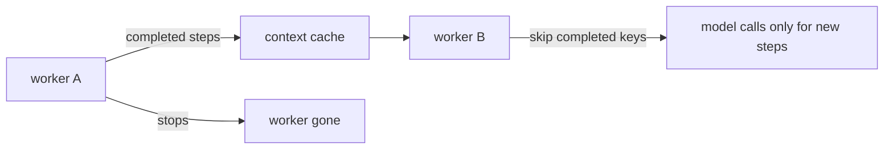

# Component: context cache

Long-running agent work should survive a change of worker. This component saves each completed step and, on resume, does not send a model call whose key is already stored. Tests count the calls on the old worker and the new worker and require the combined list to contain no duplicate key.

A hosted cache that restores work onto another server is described as ContextCache in a preview announcement. [verify] that product's behaviour, what it stores, and any pricing claim. This repository saves step outputs on the mock model and does not call a hosted cache.

Sections: [1. Purpose](#1-purpose) · [2. Architecture](#2-architecture) · [3. How it works](#3-how-it-works) · [4. Key files](#4-key-files) · [5. Code excerpts](#5-code-excerpts) · [6. Configuration](#6-configuration) · [7. Commands](#7-commands) · [8. Real output](#8-real-output) · [9. Tests and gates](#9-tests-and-gates) · [10. Guardrails](#10-guardrails) · [11. Security and governance](#11-security-and-governance) · [12. Observability](#12-observability) · [13. Failure modes](#13-failure-modes) · [14. Mapping to Azure services](#14-mapping-to-azure-services) · [15. Limitations](#15-limitations) · [16. Interview talking points](#16-interview-talking-points)

## 1. Purpose

* Let a new worker continue a session without repeating model calls that already completed.
* Treat a changed payload as a new call, so a reused output cannot hide a different input.
* Refuse to resume a session onto a different model or case.

## 2. Architecture



## 3. How it works

1. `PLAN` is four steps: extract, score, explain, cite. Score is local. The other three call `MockLLM`.
2. `call_key` hashes the session, the step id and the payload. The same inputs always produce the same key.
3. `run_plan` loads any saved state. A model step whose key is already present is skipped. Other model steps call the mock and the state is saved after each step.
4. The demo stops worker A after extract, then runs worker B on a new `MockLLM` and the same cache. Worker B makes two calls. The duplicate count is zero, and the extract output on B is the output A saved.

## 4. Key files

| File | Role |
|---|---|
| `src/modelrisk/context_cache.py` | Cache, plan, resume |
| `src/modelrisk/agents/llm.py` | Mock model whose `calls` counter the tests read |
| `tests/test_context_cache.py` | Resume, zero-call finish, changed input, isolation |

## 5. Code excerpts

<!-- code: src/modelrisk/context_cache.py::call_key -->
```python
def call_key(session_id: str, step_id: str, payload: dict[str, Any]) -> str:
    """Identity of one model call. A changed payload must not reuse the old output."""
    body = _canonical({"payload": payload, "session": session_id, "step": step_id})
    return hashlib.sha256(body.encode()).hexdigest()
```
<!-- /code -->

<!-- code: src/modelrisk/context_cache.py::run_plan -->
```python
def run_plan(
    llm: MockLLM,
    cache: ContextCache,
    session_id: str,
    model_id: str,
    case_id: str,
    evidence: dict[str, str],
    stop_after: str | None = None,
) -> tuple[WorkState, list[str]]:
    """Run ``PLAN``, skipping model steps whose call key is already saved.

    Returns the state and the call keys this worker actually sent to the model.
    """
    state = cache.load(session_id)
    if state is None:
        state = WorkState(session_id, model_id, case_id)
    elif state.model_id != model_id or state.case_id != case_id:
        raise ResumeMismatch(f"{session_id} belongs to {state.model_id}/{state.case_id}")
    by_id = {step.step_id: step for step in state.steps}
    invoked: list[str] = []
    for step in PLAN:
        if step["kind"] == "model":
            key = call_key(session_id, step["id"], {"evidence": evidence, "task": step["task"]})
            prior = by_id.get(step["id"])
            if prior is not None and prior.call_key == key:
                if stop_after == step["id"]:
                    break
                continue
            output = llm.complete(step["task"], evidence)
            invoked.append(key)
            by_id[step["id"]] = StepRecord(step["id"], "model", key, output)
        elif step["id"] not in by_id:
            by_id[step["id"]] = StepRecord(step["id"], "local", "", {"ok": True})
        state.steps = [by_id[item["id"]] for item in PLAN if item["id"] in by_id]
        cache.save(state)
        if stop_after == step["id"]:
            break
    return state, invoked
```
<!-- /code -->

## 6. Configuration

There is no service endpoint. The plan and the demo evidence are constants in `context_cache.py`. The demo session is `ses-cache` on `halcyon-fraud-triage`, case `CASE-7`.

## 7. Commands

```bash
modelrisk context-cache
```

## 8. Real output

<!-- output: context-cache -->
```text
session ses-cache model halcyon-fraud-triage case CASE-7
worker-a stopped after extract; model calls 1
worker-b resumed; model calls 2
duplicate model calls: 0
reused saved output: yes
model steps: extract, explain, cite
```
<!-- /output -->

## 9. Tests and gates

* `test_resume_does_not_repeat_completed_model_calls` checks both workers' call counts, disjoint keys, and that the saved extract output is what the new worker kept.
* A finished plan resumed later makes zero model calls. A changed memo makes three new calls whose keys do not overlap the first run.
* A second session id does not see the first session's steps. A different model or case raises `ResumeMismatch`.

## 10. Guardrails

* The cache returns a copy, so a caller who clears the loaded steps does not wipe the saved state.
* Resume refuses a different model id or case id on the same session.
* The local score step never increments the model call counter.

## 11. Security and governance

Skipping a call is safe only when the key covers the payload. Reusing an output for a different memo would be a silent error, so that case is a new call. NIST MEASURE 2.7 and MANAGE 2.4 point at this module. The saved demo text is synthetic and has no customer identifier.

## 12. Observability

The demo reports calls per worker, the duplicate count and whether the saved output was reused. A hosted deployment would send cache hits and model calls to the same place as the other governance events.

## 13. Failure modes

| Failure | Behaviour |
|---|---|
| Worker stops mid-plan | Saved steps stay; the next worker continues |
| Same step, new payload | New model call; old output is replaced |
| Session id reused for another model | `ResumeMismatch` |
| Finished plan resumed | Zero model calls |

## 14. Mapping to Azure services

* ContextCache is the hosted name, in a preview announcement, for reusing an agent's saved work on another server. [verify] what it stores and what it costs. This module stores step outputs only.
* **Foundry** would be the model the skipped call would have reached. Here the counter is `MockLLM.calls`.
* **Application Insights** would count hits against model calls so a cost spike is visible.
* **Azure Policy** can require the store that holds saved state to stay on a private network. This process keeps the cache in memory.
* **Purview** would catalogue saved agent state as a data asset. The demo state is synthetic.

## 15. Limitations

* The cache is process memory, not a shared store, and it is not a token or KV cache.
* It runs a fixed four-step plan. The five domain graphs do not checkpoint through it yet.
* Equality of the saved output is Python equality of the mock's dict, which is enough to prove the new worker did not recompute that step.
* Hosted cache behaviour is [verify].

## 16. Interview talking points

* "Worker A stops after the first model call. Worker B finishes on a new mock. The test asserts B made only the remaining calls and the combined keys have no duplicate."
