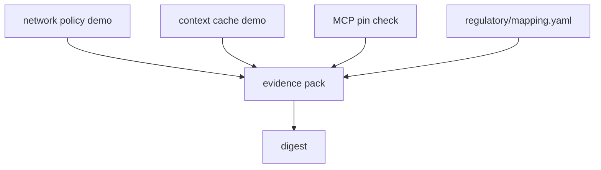

# Component: examiner evidence pack

Model risk reviewers ask for a record they can replay: what ran, what was refused, and which framework item the control supports. This component builds that record from the session network policy, the context cache and the MCP pin check, then joins it to `regulatory/mapping.yaml`. The digest is a hash of the body. The companies, cases and server declarations are synthetic.

Sections: [1. Purpose](#1-purpose) · [2. Architecture](#2-architecture) · [3. How it works](#3-how-it-works) · [4. Key files](#4-key-files) · [5. Code excerpts](#5-code-excerpts) · [6. Configuration](#6-configuration) · [7. Commands](#7-commands) · [8. Real output](#8-real-output) · [9. Tests and gates](#9-tests-and-gates) · [10. Guardrails](#10-guardrails) · [11. Security and governance](#11-security-and-governance) · [12. Observability](#12-observability) · [13. Failure modes](#13-failure-modes) · [14. Mapping to Azure services](#14-mapping-to-azure-services) · [15. Limitations](#15-limitations) · [16. Interview talking points](#16-interview-talking-points)

## 1. Purpose

* Produce one evidence pack an examiner can read without re-deriving the three controls.
* Show the network audit chain, a resume with zero duplicate model calls, and the MCP manifest result.
* Map each of those results onto the framework items that name these modules.

## 2. Architecture



## 3. How it works

1. `build_pack` runs the three demos. They are deterministic and offline.
2. `framework_rows` loads the mapping file and keeps every item whose `implemented_by` includes one of the four control modules.
3. The digest is SHA-256 over the canonical JSON of the body, with the digest field itself left out.
4. `render_pack` prints the four sections. `modelrisk examiner` exits non-zero if the audit chain fails, a model call was duplicated, or the approved manifest fails.

## 4. Key files

| File | Role |
|---|---|
| `src/modelrisk/examiner.py` | Pack, framework join, digest, text |
| `regulatory/mapping.yaml` | Framework items the pack cites |
| `tests/test_examiner.py` | Digest, duplicate count, framework refs, source links |

## 5. Code excerpts

<!-- code: src/modelrisk/examiner.py::build_pack -->
```python
def build_pack() -> dict[str, Any]:
    body = {
        "pack_id": "EX-SYNTHETIC",
        "posture": "offline synthetic; no live cloud calls",
        "network": network_demo(),
        "context_cache": cache_demo(),
        "mcp_supply": supply_demo(),
        "framework": framework_rows(),
    }
    return {**body, "digest": hashlib.sha256(_canonical(body).encode()).hexdigest()}
```
<!-- /code -->

<!-- code: src/modelrisk/examiner.py::CONTROL_MODULES -->
```python
CONTROL_MODULES = (
    "src/modelrisk/network_policy.py",
    "src/modelrisk/context_cache.py",
    "src/modelrisk/mcp_supply.py",
    "src/modelrisk/examiner.py",
)
```
<!-- /code -->

## 6. Configuration

No arguments. The pack id is `EX-SYNTHETIC`. The posture line states that the run made no live cloud calls. Changing a demo changes the digest, which is how a pasted pack in the docs stays tied to the code.

## 7. Commands

```bash
modelrisk examiner
```

## 8. Real output

<!-- output: examiner -->
```text
pack EX-SYNTHETIC
posture: offline synthetic; no live cloud calls
digest: 81d1fa2bc4ab3890cd4645eda9b573f19e9b46c706947dfe19dabf7ccd4e9da3

1. network policy
framing: agents are insider risks; the sandbox is not the policy
session ses-grid model halcyon-fraud-triage
default: deny
audit chain: ok (8)
resource                                        effect  rule              reason
----------------------------------------------  ------  ----------------  ---------------
https://models.corp.internal/foundry/score      allow   allow-model       matched allow
https://evidence.corp.internal/packs/ex-1       allow   allow-internal    matched allow
https://models.corp.internal/admin/keys         deny    deny-model-admin  explicit deny
https://payroll.corp.internal/export            deny    deny-payroll      explicit deny
https://wires.corp.internal/submit              deny    deny-wire         explicit deny
https://evil.example/collect                    deny    default-deny      deny by default
mcp://register.corp.internal/tools/query_risks  allow   allow-register    matched allow
mcp://unknown.example/exec                      deny    default-deny      deny by default
allows: 3  denies: 5

2. context cache
session ses-cache model halcyon-fraud-triage case CASE-7
worker-a stopped after extract; model calls 1
worker-b resumed; model calls 2
duplicate model calls: 0
reused saved output: yes
model steps: extract, explain, cite

3. mcp supply
approved manifest: PASS
name                                     version     registry  result  reason
---------------------------------------  ----------  --------  ------  ------
mcp-server-git                           2026.11.18  pypi      ok      pinned
@modelcontextprotocol/server-filesystem  2.4.0       npm       ok      pinned
@modelcontextprotocol/server-everything  2.3.1       npm       ok      pinned
rejected fixtures (not installed): FAIL
name                                     version     registry  result  reason
---------------------------------------  ----------  --------  ------  ---------------------------------------
mcp-server-git                           2026.11.11  pypi      FAIL    below the patched pin
@modelcontextprotocol/server-filesystem  2026.8.31   npm       FAIL    version scheme is not the pinned scheme
@modelcontextprotocol/server-filesystem  ^2.4.0      npm       FAIL    version is not an exact pin
mcp-server-fetch                         2026.11.18  pypi      FAIL    not on the allowlist
mcp-server-git                           2026.11.18  npm       FAIL    registry is not approved

4. framework map
framework    ref                evidence
-----------  -----------------  --------------------------------------------------------------
csa-ai-mrm   examined controls  modelrisk examiner
eu-ai-act    Art. 9             modelrisk gate
eu-ai-act    Art. 12            modelrisk signoff verify
eu-ai-act    Art. 15            modelrisk scenarios --model cedarhollow-underwriting-assistant
iso-42001    8                  modelrisk lifecycle
iso-42001    Annex A.10         modelrisk portfolio
nist-ai-rmf  GOVERN 6.1         modelrisk mcp-supply
nist-ai-rmf  MAP 4.1            modelrisk network-policy
nist-ai-rmf  MEASURE 2.7        modelrisk examiner
nist-ai-rmf  MANAGE 2.4         modelrisk examiner
nist-ai-rmf  MANAGE 4.1         modelrisk examiner
sr-11-7      vendor products    modelrisk mcp-supply
```
<!-- /output -->

## 9. Tests and gates

* The pack's context-cache section has `duplicate_model_calls` of 0, worker A made 1 call and worker B made 2.
* The digest is stable across two builds and matches a fresh hash of the body.
* The framework section includes the CSA examined-controls row, NIST GOVERN 6.1, MAP 4.1 and MANAGE 2.4, EU AI Act Art. 12 and Art. 15, SR 11-7 vendor products, and ISO Annex A.10.
* CI gate G1-G8 is unchanged. This pack is additional evidence, not a ninth gate.

## 10. Guardrails

* The pack does not include a timestamp, a tenant or a credential.
* Rejected MCP fixtures are labelled not installed.
* Preview product names are not executed; the docs that describe them are marked [verify].

## 11. Security and governance

The mapping file is the source of the crosswalk. Adding a module path to an item is what makes the pack cite it, so the citation cannot drift from the file the regulatory tests already check. The digest lets a reviewer see that the text matches this body.

## 12. Observability

The command is the human-readable form of the same dict the digest covers. A deployment would store that dict next to the gate report. It is not one of the `modelrisk.*` telemetry events, which stay limited to gate, scenario, residual, drift and sign-off.

## 13. Failure modes

| Failure | Behaviour |
|---|---|
| Audit chain does not verify | `modelrisk examiner` exits non-zero |
| Duplicate model call keys | exit non-zero, and the duplicate line is not zero |
| Approved MCP manifest fails | exit non-zero |
| Mapping item drops the module path | the row disappears from the pack; the test that names the ref fails |

## 14. Mapping to Azure services

* The pack is the object that would be written to the versioned, keyless evidence account beside `evidence/gate-report.json`. Nothing is uploaded here.
* **Application Insights** holds runtime events. This pack is the examiner's bundle, not a trace.
* **Azure Policy** assignments and **Purview** assets are cited by the controls inside the pack; the pack itself is the index.
* **Foundry** evaluation runs are a different evidence type. This pack shows session policy, resume and supply-chain pins.
* Hosted sandbox and cache products named in the source announcement are [verify] and are not part of the run.

## 15. Limitations

* Synthetic. It shows that the controls behave as coded. It is not an examination opinion and not a legal mapping.
* It replays fixed demos, not a live session from one of the five domain agents.
* The digest covers this process's output. It does not timestamp a signature or bind an identity.

## 16. Interview talking points

* "The pack is generated, not written. It shows the denies, zero duplicate model calls, the pinned MCP servers, and the framework rows those files implement, then hashes the body."
