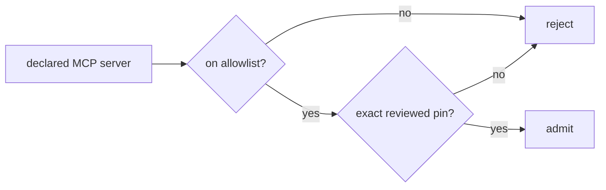

# Component: MCP server pin and allowlist

An agent that can call an MCP server is depending on someone else's code. This component admits a declared server only when the package is on an allowlist, the registry matches, and the version is an exact pin equal to the reviewed version. It does not install a server and it does not describe how an unpatched server fails.

The reviewed pins are the patched releases in the reference-server release v2.5.0: `mcp-server-git` 2026.11.18, `@modelcontextprotocol/server-filesystem` 2.4.0 and `@modelcontextprotocol/server-everything` 2.3.1. Source: [v2.5.0](https://github.com/modelcontextprotocol/servers/releases/tag/v2.5.0). A package published in that release is not approved until it is named here. [verify] any later advisory before changing a pin; this module does not fetch one.

Sections: [1. Purpose](#1-purpose) · [2. Architecture](#2-architecture) · [3. How it works](#3-how-it-works) · [4. Key files](#4-key-files) · [5. Code excerpts](#5-code-excerpts) · [6. Configuration](#6-configuration) · [7. Commands](#7-commands) · [8. Real output](#8-real-output) · [9. Tests and gates](#9-tests-and-gates) · [10. Guardrails](#10-guardrails) · [11. Security and governance](#11-security-and-governance) · [12. Observability](#12-observability) · [13. Failure modes](#13-failure-modes) · [14. Mapping to Azure services](#14-mapping-to-azure-services) · [15. Limitations](#15-limitations) · [16. Interview talking points](#16-interview-talking-points)

## 1. Purpose

* Keep third-party MCP servers on an allowlist of exact, reviewed versions.
* Reject a version below the patched pin, a newer version that has not been reviewed, a range, a floating tag, the wrong registry, and a date-style version where the pin is semantic.
* Make "published" and "approved" different answers.

## 2. Architecture



## 3. How it works

1. `APPROVED` maps three package names to a scheme (`calver` or `semver`), one version tuple and a registry.
2. `parse_exact_pin` accepts digits and dots only. A caret, a tag such as `latest`, a leading `v` or a space is not a pin.
3. A three-part version whose first component is a calendar year is `calver`. Anything else well-formed is `semver`. A date-style version therefore cannot satisfy a semantic pin. Installers can order a date-style number above the patched semantic release, so an unpinned upgrade will not land on the fix. The check rejects that shape instead.
4. `check_server` compares the parsed tuple with the reviewed pin. Older is `below the patched pin`. Newer is `not the reviewed pin`. Equal, on the right registry, is `pinned`.
5. The demo checks the approved manifest and a small set of fixtures that are not installed.

## 4. Key files

| File | Role |
|---|---|
| `src/modelrisk/mcp_supply.py` | Pins, parser, check, demo |
| `tests/test_mcp_supply.py` | Patched versions, rejections, defensive source check |
| `src/modelrisk/mcp_server.py` | This repo's own read-only register, which is not one of the pinned packages |

## 5. Code excerpts

<!-- code: src/modelrisk/mcp_supply.py::check_server -->
```python
def check_server(server: ServerDecl) -> Finding:
    pin = APPROVED.get(server.name)
    if pin is None:
        return Finding(server.name, server.version, server.registry, False, "not on the allowlist")
    if server.registry != pin.registry:
        return Finding(server.name, server.version, server.registry, False, "registry is not approved")
    parsed = parse_exact_pin(server.version)
    if parsed is None:
        return Finding(server.name, server.version, server.registry, False, "version is not an exact pin")
    scheme, nums = parsed
    if scheme != pin.scheme:
        return Finding(server.name, server.version, server.registry, False, "version scheme is not the pinned scheme")
    if len(nums) != len(pin.version):
        return Finding(server.name, server.version, server.registry, False, "version width does not match the pin")
    if nums < pin.version:
        return Finding(server.name, server.version, server.registry, False, "below the patched pin")
    if nums > pin.version:
        return Finding(server.name, server.version, server.registry, False, "not the reviewed pin")
    return Finding(server.name, server.version, server.registry, True, "pinned")
```
<!-- /code -->

## 6. Configuration

<!-- code: src/modelrisk/mcp_supply.py::APPROVED -->
```python
APPROVED: dict[str, Pin] = {
    "mcp-server-git": Pin("calver", (2026, 11, 18), "pypi"),
    "@modelcontextprotocol/server-filesystem": Pin("semver", (2, 4, 0), "npm"),
    "@modelcontextprotocol/server-everything": Pin("semver", (2, 3, 1), "npm"),
}
```
<!-- /code -->

Add a newer release by replacing the tuple after review. Do not replace the tuple with a range.

## 7. Commands

```bash
modelrisk mcp-supply
```

## 8. Real output

<!-- output: mcp-supply -->
```text
approved manifest: PASS
name                                     version     registry  result  reason
---------------------------------------  ----------  --------  ------  ------
mcp-server-git                           2026.11.18  pypi      ok      pinned
@modelcontextprotocol/server-filesystem  2.4.0       npm       ok      pinned
@modelcontextprotocol/server-everything  2.3.1       npm       ok      pinned
rejected fixtures (not installed): FAIL
name                                     version     registry  result  reason
---------------------------------------  ----------  --------  ------  ---------------------------------------
mcp-server-git                           2026.11.11  pypi      FAIL    below the patched pin
@modelcontextprotocol/server-filesystem  2026.8.31   npm       FAIL    version scheme is not the pinned scheme
@modelcontextprotocol/server-filesystem  ^2.4.0      npm       FAIL    version is not an exact pin
mcp-server-fetch                         2026.11.18  pypi      FAIL    not on the allowlist
mcp-server-git                           2026.11.18  npm       FAIL    registry is not approved
```
<!-- /output -->

## 9. Tests and gates

* The approved manifest passes. An empty manifest fails.
* Below-pin, unreviewed newer, date-style on a semantic package, ranges, `latest`, a leading `v`, the wrong registry, a lookalike name, and `mcp-server-fetch` at the same calendar version as the git pin (published, not allowlisted) all fail with a fixed reason.
* `test_supply_module_stays_defensive` refuses exploit wording and network clients in this module.

## 10. Guardrails

* No registry lookup and no install.
* Unknown packages fail closed, including packages shipped in the same release but not named here.
* The version has to be exact. `>=` is a policy failure, not a convenience.

## 11. Security and governance

This is the third-party control behind NIST GOVERN 6.1, ISO Annex A.10 and the SR 11-7 vendor-products row. The read-only register in `mcp_server.py` is first-party and is not subject to these pins. OWASP LLM03 and the supply-chain row of the threat model point here.

## 12. Observability

Each finding is a name, version, registry, pass or fail, and a reason. The examiner pack includes both the approved manifest and the rejected fixtures, labelled as not installed.

## 13. Failure modes

| Failure | Reason |
|---|---|
| Older than the patched pin | `below the patched pin` |
| Newer than the reviewed pin | `not the reviewed pin` |
| Date-style version on a semantic pin | `version scheme is not the pinned scheme` |
| Range, tag or leading v | `version is not an exact pin` |
| Wrong registry or unknown name | `registry is not approved` or `not on the allowlist` |

## 14. Mapping to Azure services

* **Azure Policy** can deny an unapproved container image. This check denies an unapproved MCP server declaration. They are different layers.
* **Foundry** tool registration, in a real deployment, would list only servers this check has passed.
* **Application Insights** would log rejections. Here they are rows in the command output.
* **Purview** catalogues third-party tool sources and the version that was approved.
* No hosted pin service is claimed. [verify] any portal control that appears to approve MCP servers automatically.

## 15. Limitations

* The check trusts the version string it is given. It does not hash a wheel or an npm tarball, and it does not read a lockfile from this repository's own `mcp` dependency (that package is the protocol library, not a reference server).
* It does not watch for a later advisory. A new pin is a reviewed change.
* It does not reproduce, detect or explain a vulnerability. It only answers whether the declaration matches the allowlist.

## 16. Interview talking points

* "Pinned means that exact version. Older than the patched release fails, and a newer release stays out until someone reviews it. A date-style version does not satisfy a semantic pin, because an installer can treat the date as newer and skip the fix."
