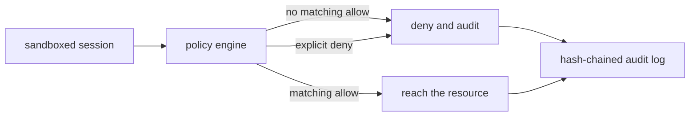

# Component: session network policy

A sandboxed agent is an insider. The sandbox stops code the agent wrote from running on the worker. It does not decide which network resources that session may reach. This component is a deny-by-default policy engine for one session, with an explicit deny that beats a broader allow, and a hash-chained audit log of every decision.

The hosted pattern of enforcing that policy next to the sandbox is described as Agent Grid in a preview announcement. [verify] that product's behaviour, limits and service terms before treating this module as a description of it. This repository does not call Azure.

Sections: [1. Purpose](#1-purpose) · [2. Architecture](#2-architecture) · [3. How it works](#3-how-it-works) · [4. Key files](#4-key-files) · [5. Code excerpts](#5-code-excerpts) · [6. Configuration](#6-configuration) · [7. Commands](#7-commands) · [8. Real output](#8-real-output) · [9. Tests and gates](#9-tests-and-gates) · [10. Guardrails](#10-guardrails) · [11. Security and governance](#11-security-and-governance) · [12. Observability](#12-observability) · [13. Failure modes](#13-failure-modes) · [14. Mapping to Azure services](#14-mapping-to-azure-services) · [15. Limitations](#15-limitations) · [16. Interview talking points](#16-interview-talking-points)

## 1. Purpose

* Decide, for one sandboxed session, which resources it may reach.
* Deny when no allow matches. An explicit deny wins over a broader allow, which is how a session misuses access it was given.
* Record every decision on a hash-chained log an examiner can check.

## 2. Architecture



## 3. How it works

1. `open_session` copies the rules into a tuple. The session has no method that adds a grant.
2. `parse_resource` accepts only `scheme://host/path`. User info, a port, a query or a fragment fails closed.
3. `evaluate` collects matching rules. Any explicit deny wins. Otherwise the most specific allow wins. Otherwise the decision is deny.
4. `Session.reach` appends the decision to `AuditLog`. `verify` recomputes the chain the same way the sign-off log does.

## 4. Key files

| File | Role |
|---|---|
| `src/modelrisk/network_policy.py` | Rules, evaluation, audit log, demo |
| `tests/test_network_policy.py` | Deny, specificity, tamper, fail-closed parsing |

## 5. Code excerpts

<!-- code: src/modelrisk/network_policy.py::evaluate -->
```python
def evaluate(rules: tuple[Rule, ...] | list[Rule], resource: Resource) -> tuple[str, str, str]:
    """Return ``(effect, rule id, reason)``. No matching allow is a deny."""
    matched = [rule for rule in rules if rule_matches(rule, resource)]
    denies = [rule for rule in matched if rule.effect == "deny"]
    if denies:
        rule = _pick(denies)
        return "deny", rule.id, "explicit deny"
    allows = [rule for rule in matched if rule.effect == "allow"]
    if allows:
        return "allow", _pick(allows).id, "matched allow"
    return "deny", "default-deny", "deny by default"
```
<!-- /code -->

## 6. Configuration

The enterprise rules grant the internal estate, then carve out payroll, payments and the model admin plane. The public internet has no allow, so it is denied.

<!-- code: src/modelrisk/network_policy.py::ENTERPRISE_RULES -->
```python
ENTERPRISE_RULES: tuple[Rule, ...] = (
    Rule("allow-internal", "allow", "https", "*.corp.internal", "/", "internal estate granted to the session"),
    Rule("allow-model", "allow", "https", "models.corp.internal", "/foundry", "scoring route only"),
    Rule("deny-model-admin", "deny", "https", "models.corp.internal", "/admin", "admin plane is not an agent route"),
    Rule("deny-payroll", "deny", "https", "payroll.corp.internal", "/", "payroll is not an agent task"),
    Rule("deny-wire", "deny", "https", "wires.corp.internal", "/", "payments stay with people"),
    Rule("allow-register", "allow", "mcp", "register.corp.internal", "/", "read-only risk register"),
)
```
<!-- /code -->

## 7. Commands

```bash
modelrisk network-policy
```

## 8. Real output

<!-- output: network-policy -->
```text
framing: agents are insider risks; the sandbox is not the policy
session ses-grid model halcyon-fraud-triage
default: deny
audit chain: ok (8)
resource                                        effect  rule              reason
----------------------------------------------  ------  ----------------  ---------------
https://models.corp.internal/foundry/score      allow   allow-model       matched allow
https://evidence.corp.internal/packs/ex-1       allow   allow-internal    matched allow
https://models.corp.internal/admin/keys         deny    deny-model-admin  explicit deny
https://payroll.corp.internal/export            deny    deny-payroll      explicit deny
https://wires.corp.internal/submit              deny    deny-wire         explicit deny
https://evil.example/collect                    deny    default-deny      deny by default
mcp://register.corp.internal/tools/query_risks  allow   allow-register    matched allow
mcp://unknown.example/exec                      deny    default-deny      deny by default
allows: 3  denies: 5
```
<!-- /output -->

## 9. Tests and gates

* Tests cover default deny, an explicit deny beating a broad allow, the admin route on the model host, suffix and path lookalikes, fail-closed parsing, a caller who appends a rule after the session opens, and a tampered or deleted audit entry.
* These checks are not part of CI gate G1-G8. `modelrisk examiner` replays the same demo.

## 10. Guardrails

* No sockets. A decision is a string, not a connection.
* The session cannot widen its own policy.
* Odd resource strings are refused rather than normalised into a match.

## 11. Security and governance

The framing is that agents are insider risks. Isolation without a reach policy leaves the grants the session already has. The audit chain is the record that a later reviewer uses. NIST MAP 4.1 and MANAGE 2.4 in `regulatory/mapping.yaml` point here.

## 12. Observability

Each decision is an audit entry with a session id, a model id, the resource, the effect and the rule. A hosted deployment would emit the same fields as custom events. The log here stays in the process that ran the demo.

## 13. Failure modes

| Failure | Behaviour |
|---|---|
| No matching allow | Deny, rule `default-deny` |
| Broad internal allow plus a tighter deny | Explicit deny wins |
| Edited or deleted audit entry | `verify` fails |
| Resource with a user, port, query or fragment | `PolicyError`, no decision |

## 14. Mapping to Azure services

* The preview description of a policy next to the agent sandbox is the idea this module stands in for. [verify] hosted behaviour. This code does not call it.
* **Azure Policy** remains the org-wide control on resource tags and public endpoints (`infra/policies`). This engine is the session-level decision those policies do not express.
* **Application Insights** would take one custom event per decision. `modelrisk telemetry` is unchanged; the examiner pack is the bundle.
* **Purview** catalogues the model endpoint and the evidence store as the destinations an allow names.
* **Foundry** is the model host an allow rule can name. The domain agents still call `MockLLM`.

## 15. Limitations

* This is not a packet filter, a firewall and not a private-link design. It classifies a resource string.
* The five domain agents do not yet call `reach` on every node. The engine and the examiner demo are the control.
* Host patterns are exact, `*` or `*.suffix`. There is no regular expression.
* Product limits of the hosted sandbox service are [verify].

## 16. Interview talking points

* "A sandbox stops the agent's code leaving the worker. It does nothing about a destination the agent was allowed to use, so the session is deny-by-default and every reach is on the audit chain."
